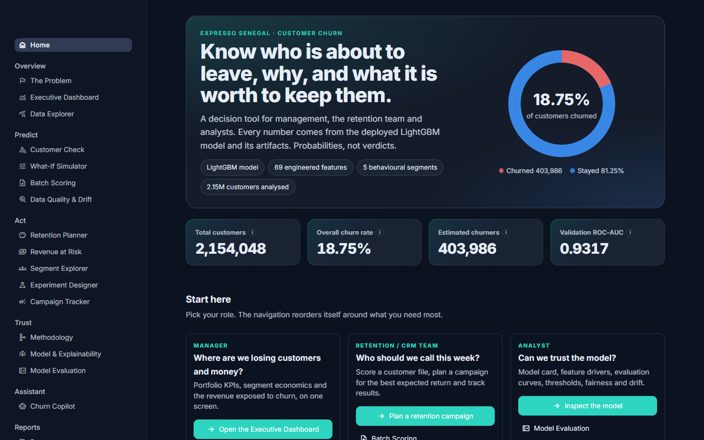
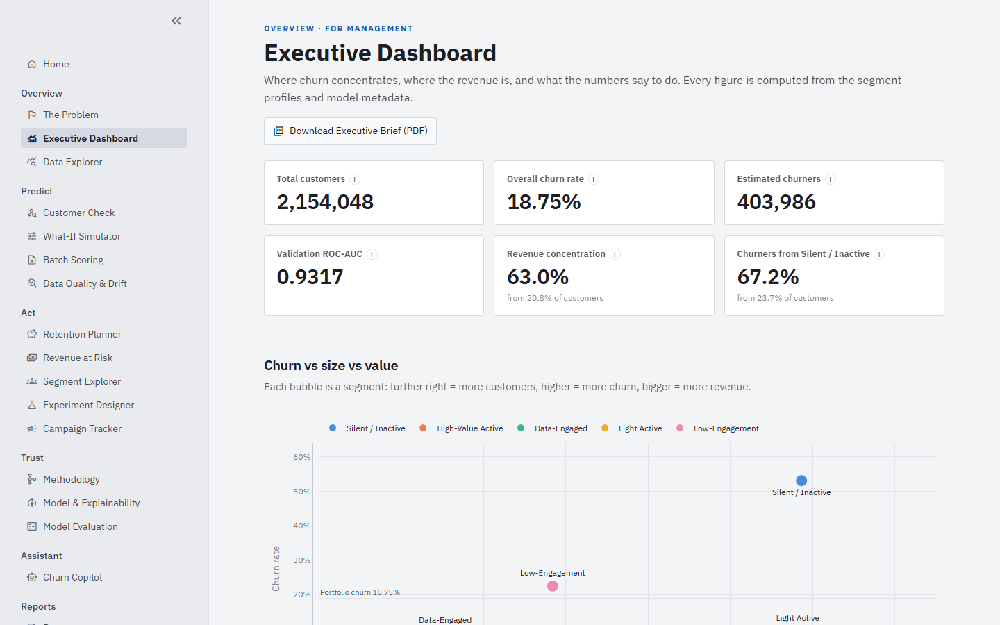
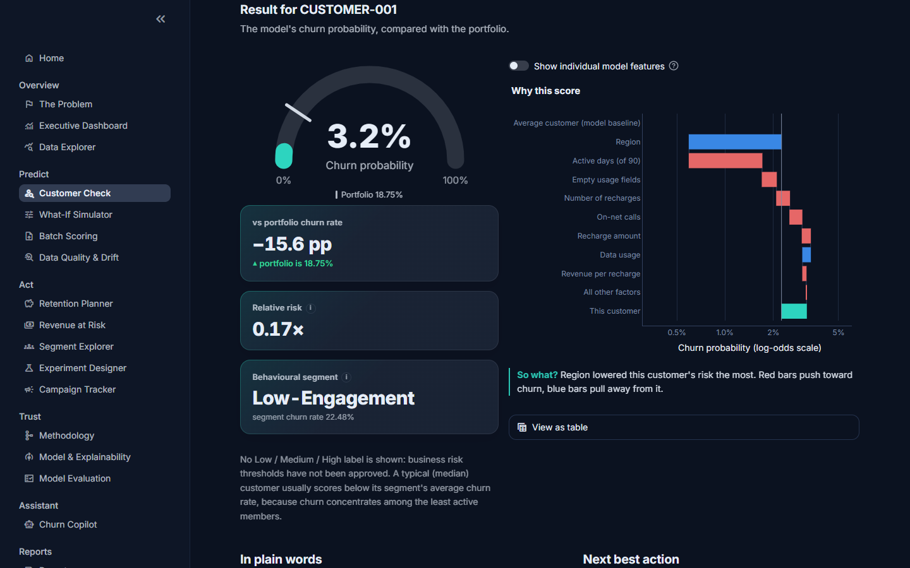
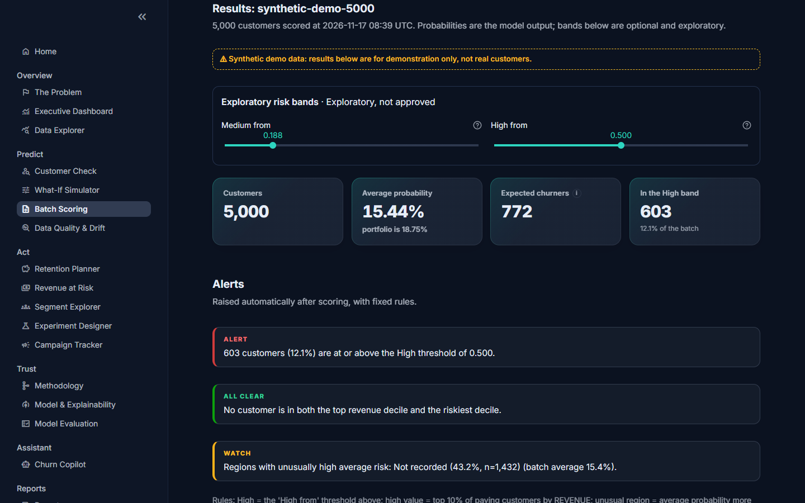
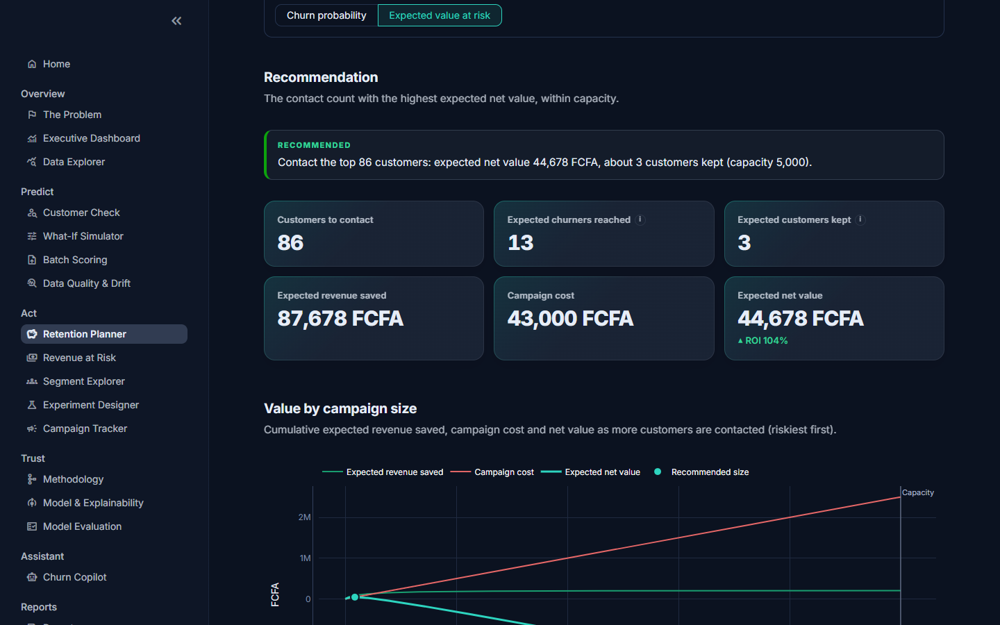
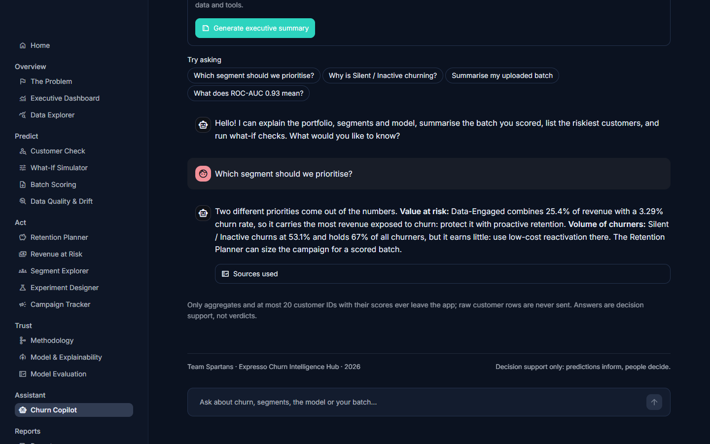

# Expresso Churn Intelligence Hub

A decision tool for **Expresso Senegal's** management, retention/CRM team and analysts: who is likely to leave, why,
what it is worth to keep them, and how far to trust the model. Built by **Team Spartans** as a capstone project on
the Zindi *Expresso Churn Prediction* data.

**Live app:** churn-prediction-capstone.streamlit.app

> Every figure in the app is computed from the files in `artifacts/`, from the deployed model's live output, or from
> data you upload. The app shows **probabilities, not verdicts**: business risk thresholds have not been approved, so
> any Low / Medium / High banding is user-chosen and labelled *exploratory*.

---

## Team Spartans

Daniel Chirchir · Daniel Tabut · Livingstone Talel · Sandra Bosibori · Patrick Palex · Immanuel Ochieng

---

## What's inside

The navigation is grouped by job, and a **View as** selector (Executive / Retention team / Analyst) reorders it so each
role sees its most useful pages first. Everything is available in **English and French**.

| Section | Page | What it does |
|---|---|---|
| Overview | **Home** | Hero with the four headline KPIs, routes for each persona, guided tour, team. |
| | **The Problem** | Why churn matters to Expresso, who uses the app and for which decisions, success criteria measured against the evidence, clickable CRISP-DM steps. |
| | **Executive Dashboard** | Six KPIs, churn-vs-size-vs-value bubble chart, treemap, churners vs revenue, computed insights, model drivers, one-click **Executive Brief (PDF)**. |
| | **Data Explorer** | Training-data overview, missingness (and why it predicts churn), a "churn rate by…" explorer, churner vs non-churner distributions, computed key findings. *Needs exported files.* |
| Predict | **Customer Check** | Score one customer; animated gauge vs the portfolio rate; **reason codes** from LightGBM's own contributions (waterfall + plain sentences); rule-based **next best action**; presets from segment medians. |
| | **What-If Simulator** | Move behaviour levers and compare baseline vs scenario; per-lever sensitivity sweep ("which lever helps most?"). |
| | **Batch Scoring** | CSV template, synthetic demo data, plain-language validation report, chunked scoring with progress, risk deciles, exploratory bands, **alerts**, filters, charts by region/tenure/segment, **Customer 360**, CSV/Excel/priority-call-list downloads. |
| | **Data Quality & Drift** | PSI per column against the training data (traffic lights), missing-rate changes, unseen categories, plain-English warnings. *Needs exported files.* |
| Act | **Retention Planner** | ROI by campaign size under your assumptions, recommended K within capacity, expected gains/lift, target list export; flags when probability ranking loses money and offers value ranking. |
| | **Revenue at Risk** | Segment waterfall (customers × churn × median revenue) and expected revenue at risk (probability × REVENUE) in a scored batch by region and tenure. |
| | **Segment Explorer** | Two-segment comparison, radar, benchmark deltas, generated interpretation, the team's playbook, 2×2 strategy matrix. |
| | **Experiment Designer** | A/B test sample size, seeded treatment/control split of the call list with achieved power, weeks needed, and results analysis (uplift, CI, p-value, verdict). |
| | **Campaign Tracker** | Campaign log (CSV export/import), one-click row from the Retention Planner, realised vs planned retention and ROI. |
| Trust | **Methodology** | Feature-engineering table generated from the config, class imbalance, validation strategy, why ROC-AUC, limitations and ethics. |
| | **Model & Explainability** | Model card (intended use, limitations), gain/split importance grouped back to raw columns, all 69 features explained. |
| | **Model Evaluation** | Model comparison leaderboard, ROC, precision-recall, calibration, confusion matrix with a threshold slider in business words, gains/lift, **threshold advisor** (cost-based, for discussion), **fairness** by region and tenure. |
| Assistant | **Churn Copilot** | Chat answered by Claude using 13 aggregate-only tools over the app's data, with sources shown; one-click **executive summary** (PDF); offline FAQ mode without an API key. |
| Reports | **Reports** | Executive Brief PDF, scored files, call list, data dictionary, model metadata, segment profiles, feature list, deployment summary. |

Pages marked *needs exported files* show an empty state naming the file and the command until
`scripts/export_artifacts.py` has been run (see below).

Global extras:

- **English / French** toggle in the sidebar: every string, chart label, insight, PDF and the Copilot's answers switch,
  and numbers use French formatting in French.
- **View as** Executive / Retention team / Analyst reorders the navigation around each role.
- **Guided tour** ("Take the tour" on Home) walks through the key pages with step cards.
- **Presentation mode** hides the sidebar and controls and enlarges KPIs and charts for a defence.
- Sidebar model-status and data-in-session badges, glossary popover, optional password gate, an error boundary around
  every page, footer with the decision-support disclaimer.
- Accessibility: colour-blind-safe palette validated in both themes, status never shown by colour alone, a "So what?"
  caption, screen-reader text and a table view under every chart, light and dark themes with sufficient contrast.

### Screenshots

Add screenshots to `docs/screenshots/` and they will render here.

| Home | Executive Dashboard | Customer Check |
|---|---|---|
|  |  |  |
| **Batch Scoring** | **Retention Planner** | **Churn Copilot** |
|  |  |  |

---

## Run it locally

Python **3.12** is required: the model bundle was pickled with numpy 1.26.4, pandas 2.3.3, scikit-learn 1.8.0 and
LightGBM 4.6.0, and `requirements.txt` pins exactly those.

```bash
python -m venv .venv
# Windows: .venv\Scripts\activate    macOS/Linux: source .venv/bin/activate
pip install -r requirements.txt
streamlit run Home.py
```

The app opens with no data and no API key: every page shows a helpful empty state, Batch Scoring can generate synthetic
demo data, and the Copilot runs in offline FAQ mode.

### Secrets (optional)

Copy `.streamlit/secrets.toml.example` to `.streamlit/secrets.toml` (git-ignored), or paste the same keys into
**Streamlit Community Cloud → App settings → Secrets**.

| Key | Effect |
|---|---|
| `ANTHROPIC_API_KEY` | Enables free-form Copilot answers from Claude. Without it the Copilot uses its offline FAQ. |
| `COPILOT_MODEL` | Claude model for the Copilot (default `claude-opus-5-5`). |
| `COPILOT_EFFORT` | `low` / `medium` / `high` (default `medium`). |
| `APP_PASSWORD` | If set, viewers must enter it once per session. If unset, the app is open. |

Keys are only ever read from `st.secrets`; none are hard-coded.

### Exporting the evidence files (run once)

The repository holds no customer data. The evidence pages (Data Explorer, Model Evaluation's comparison, curves and
fairness, Data Quality & Drift, richer Customer Check presets) read small aggregate files produced once from the Zindi
`Train.csv`:

```bash
python scripts/export_artifacts.py --train path/to/Train.csv
# options: --test-size 0.2   --no-stratify   --baseline-sample 400000   --holdout-refit   --out artifacts/
```

| File | Contents |
|---|---|
| `eda_summary.json` | Row counts, churn rate, missing % per column, numeric statistics by churn class, per-segment medians, a check of the segment rule |
| `eda_breakdowns.parquet` | Churn rate and counts by tenure, region, MRG, active-day bins, top 15 packs and value deciles |
| `validation_predictions.parquet` | `y_true`, `y_prob`, `REGION`, `TENURE` for the validation split (no customer IDs) |
| `model_comparison.csv` | Dummy, Logistic Regression and the deployed LightGBM on the validation split |
| `reference_stats.json` | Training distributions for drift (PSI) checks |
| `export_manifest.json` | Split settings, sanity checks, file sizes |

Notes for the team:

- The script reuses `app/utils/prediction.py` and seed 42. Pass the same `--test-size` and stratification your notebook
  used. It writes aggregates only (about 0.4 MB per 300k rows; well under 20 MB for the full file).
- The deployed model appears to have been refit on all rows (379 trees vs best iteration 345). The script warns if the
  deployed model scores above the recorded AUC on the split; add `--holdout-refit` to train a copy with the same
  settings on the training split only, and the app will use those honest predictions for evaluation.
- It checks the reconstructed segment rule against `segment_profiles.csv` and records the result in the manifest.
- Tested end to end on synthetic data shaped like Train.csv (300k rows in about 2 minutes on a laptop).

### Exporting validation predictions from the notebook (alternative)

Model Evaluation reads `artifacts/validation_predictions.parquet` (columns `y_true`, `y_prob`, optionally `REGION`,
`TENURE`). Export it from the training notebook **with the model fitted on the training split only** (before any final
refit on all rows, otherwise the curves are optimistic):

```python
import pandas as pd

pd.DataFrame({
    "y_true": y_valid.astype("int8"),
    "y_prob": model_trained_on_train_split.predict_proba(X_valid)[:, 1].astype("float32"),
    "REGION": raw_valid["REGION"].astype("string"),
    "TENURE": raw_valid["TENURE"].astype("string"),
}).to_parquet("artifacts/validation_predictions.parquet", index=False)
```

Without this file you can still upload any labelled file (with a `CHURN` column) on the Model Evaluation page.

---

## Tests and checks

```bash
pip install -r requirements-dev.txt
pytest   # 100+ tests: parity, preprocessing, scoring, metrics, PSI, A/B statistics, Copilot tools and loop,
         # export script end to end, AppTest smoke tests of every page in EN and FR, with and without exports
python scripts/benchmark_batch.py --rows 100000   # time and peak memory of a 100k-row batch
```

The suite includes a **parity test**: the refactored, chunked scoring path must give exactly the same probabilities as
a verbatim copy of the first deployment's preprocessing (`tests/reference_prediction_dd86793.py`).

Measured on a laptop: 100,000 rows read and validated in 1.7 s, scored in 16 s (with reason codes for the riskiest
2,000), peak memory 260 MB, comfortably inside Streamlit Community Cloud's ~1 GB.

---

## How it is built

```
Home.py                  entrypoint: theme, password gate, st.navigation router, sidebar, tour, footer
app_pages/               one file per page
app/utils/prediction.py  canonical preprocessing (unchanged model logic, 69 features)
app/core/                scoring, explanations, segments, metrics, validation, demo data, PDF, ...
app/copilot/             Copilot tools, Claude streaming loop, executive summary, offline FAQ
app/ui/                  components (KPI cards, callouts, gauge), Plotly house style, layout, style.css
app/i18n/                en.json and fr.json: every UI string
artifacts/               model bundle, metadata, segment profiles, feature list, preprocessing config
scripts/                 export_artifacts.py (evidence files) and benchmark_batch.py
tests/                   pytest suite
```

Design rules the code follows:

- **The model and preprocessing are unchanged**: same 69 features, same order, same LightGBM bundle.
- **One segment map**, verified against the bundle's segmentation config: 0 Silent / Inactive, 1 High-Value Active,
  2 Data-Engaged, 3 Light Active, 4 Low-Engagement (`app/core/segments.py`).
- **Reason codes** use LightGBM's `pred_contrib` (TreeSHAP) on the deployed model; no SHAP dependency. Contributions
  plus the baseline add up exactly to the model's score (tested).
- **Next best actions** are business rules on top of the reason codes and are labelled as suggestions.
- **The Copilot** sees only aggregates and at most 20 customer IDs with their scores; raw rows never leave the app.

### Deploying on Streamlit Community Cloud

- Main file: `Home.py`. Under *Advanced settings*, choose **Python 3.12** (`runtime.txt` and `.python-version` record
  the same pin).
- Add secrets as above if you want the Copilot or a password.
- `.streamlit/config.toml` sets the theme and turns off the source-file watcher (it can stall the server on large
  dependency trees). While developing, run `streamlit run Home.py --server.fileWatcherType auto` to get reload-on-save.

---

## Model at a glance

| | |
|---|---|
| Model | LightGBM classifier (379 trees; best validation iteration 345) |
| Validation ROC-AUC | 0.9317 (seed-42 split) |
| Training rows | 2,154,048 |
| Features | 69 engineered from 17 raw columns |
| Risk thresholds approved | No (probabilities only) |

Known limitations are listed on the Model & Explainability page: duplicated missing-value indicators, an apparent final
refit on all rows (so re-scoring the validation split with the deployed model is optimistic), "region not recorded" as
the strongest signal (a proxy for inactivity), and a 90-day snapshot.

*Decision support only: predictions inform, people decide.*
